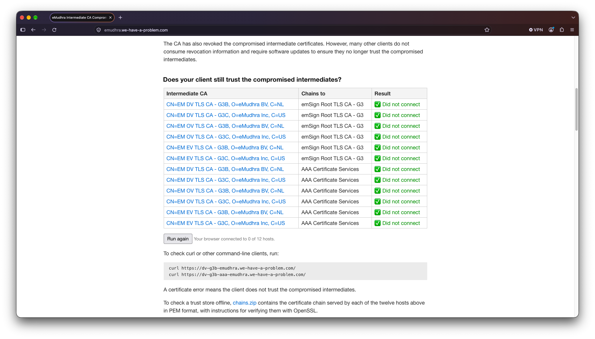

+++
title = "Firefox 158.0.1"
date = 2026-10-21
# updated =
description = "Release 158.0.1 · ESR 153.5.1esr · Beta 159.0b4 · Developer Edition 159.0b4 · Nightly 160.0a1"
[taxonomies]
categories = ["__04__Firefox"]
tags = ["firefox", "web", "release-note"]
[extra]
lang = "ja"
toc = true
math = true
mermaid = true
+++

Firefox 158.0.1 - 2026/10/20 に Release チャンネルユーザー向けにリリースされています．このリリースは [158.0](/posts/firefox-158-0/) への修正パッチです

(Release 158.0.1 · ESR 153.5.1esr · Beta 159.0b4 · Developer Edition 159.0b4 · Nightly 160.0a1)

## Fixed

- 証明書のブロックリストである OneCRL を更新し，改ざんされた「eMudhra」中間証明書をブロックしました．
  - 2026/10/17 20:06 (UTC) に Mozilla は eMudhra の8個に及ぶ中間証明書に対応する秘密鍵が侵害されたという報告を受けています．
  - これらの鍵は悪用されると，攻撃者は自身で管理していないウェブサイトに対して偽の HTTPS 証明書を発行することができます．
  - 報告を受けてから3時間足らずの同日 22:59 までに標準設定のすべての Firefox ユーザー向けに更新された OneCRL の配布が完了しています．
  - **またデスクトップ版及び Android 版向けの Firefox 158.0.1 及び Firefox ESR 153.5.1 にてカスタム設定により OneCRL の更新を受け取れなかった一部のユーザーに対してもこの保護措置が適用されています**．
  - 詳細: [Protecting Firefox users following the compromise of eMudhra intermediate certificates - Mozilla Security Blog](https://blog.mozilla.org/security/2026/10/20/protecting-firefox-users-following-the-compromise-of-emudhra-intermediate-certificates/)
- テキストを選択した際にページが予期せず，先頭までスクロールしてしまう不具合を修正 ([Bug 2081016](https://bugzilla.mozilla.org/show_bug.cgi?id=2081016))
- スクリーンリーダーやその他のアクセシビリティ機能が有効になっている際にページを PDF として保存したりした際に Windows でのみ発生していたクラッシュを修正 ([Bug 2082376](https://bugzilla.mozilla.org/show_bug.cgi?id=2082376))
- Linux のマルチモニター環境で Firefox が誤ったモニターにウィンドウを開いてしまう不具合を修正 ([Bug 2076558](https://bugzilla.mozilla.org/show_bug.cgi?id=2076558))
- 一部のユーザーにおいて組み込み VPN が有効にならない不具合を修正 ([Bug 2055094](https://bugzilla.mozilla.org/show_bug.cgi?id=2055094))
- macOS において，他のアプリケーションから Firefox にドラッグされたファイルがページ上にドロップされない不具合を修正 ([Bug 2078954](https://bugzilla.mozilla.org/show_bug.cgi?id=2078954))
- [その他多くのセキュリティ修正](https://www.mozilla.org/security/advisories/mfsa2026-111)

### 保護措置のテスト

手元の Firefox ビルドでこの保護措置が適用されているかを確認するには Mozilla の Dennis Jackson 氏が公開した検証サイトを使用します．問題がなければ *Did not connect* と表示されます．

[eMudhra Intermediate CA Compromise](https://emudhra.we-have-a-problem.com/)

