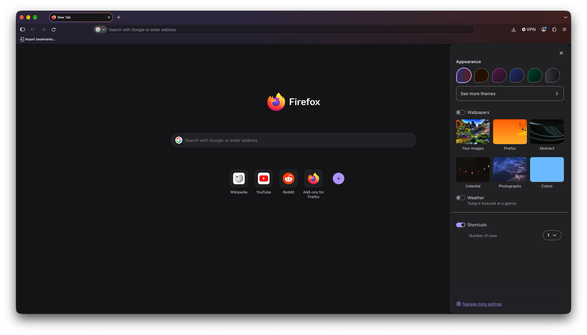

+++
title = "Firefox 158.0"
date = 2026-10-16
# updated =
description = "Release 158.0 · ESR 140.17.0esr · Beta 159.0b1 · Developer Edition 159.0b1 · Nightly 160.0a1"
[taxonomies]
categories = ["__04__Firefox"]
tags = ["firefox", "web", "release-note"]
[extra]
lang = "ja"
toc = true
math = true
mermaid = true
+++

Firefox 158.0 - 2026/10/13 に Release チャンネルユーザー向けにリリースされています

(Release 158.0 · ESR 140.17.0esr · Beta 159.0b1 · Developer Edition 159.0b1 · Nightly 160.0a1)

## Features

- Smart Window においてフォームフィールドをクリックした時，または Fill from sources を選択したときに，関連するタブと保存している自動入力データに基づいて，入力に使用するデータが提案されるようになりました (段階的ロールアウト)
- ページを PDF として保存する時，Linux / macOS において Firefox がよりアクセシブルな PDF を作成できるように
- JPEG XL 画像フォーマットに対応[^1]
  - 以前まで Firefox Labs で提供されていた試験的機能の一つです．
- New Tab で直近の1枚だけでなく，カスタム壁紙を Your images に保持するようになりました



- 翻訳機能が次の言語に対応しました
  - アルバニア語
  - ベラルーシ語
  - フィリピン語

## Fixed

- 数式記号が欠けるなど， PDF レンダリングに関する不具合を修正
- Ubuntu のデフォルトテーマで，キーボードに選択した際にアドレスバー結果の Favicon がハイライト色に埋もれてしまう不具合を修正
- Favicon 読み込み時にクラッシュすることがある不具合を修正
- Windows と Linux でアドレスバーの Unified Search Button メニューにおいて，各検索エンジン名と先頭文字に下線が表示され，キーボードショートカットが競合しうる問題を修正
- Windows のハイコントラストテーマで，各メニューが読みにくい問題を修正
  - メニューの背景色と文字色は Windows 設定でカスタムコントラストテーマに選んだ色に従うように．
- [その他多くのセキュリティ不具合を修正](https://www.mozilla.org/en-US/security/advisories/mfsa2026-106/)

## Changed

- スクロール位置を整数のスクリーンピクセルに丸めないように
  - 特に高解像度ディスプレイやページをズームしている場合にスクロールがより滑らかかつ正確になります．

## Developer

[Firefox 158 release notes for developers (Stable)](https://developer.mozilla.org/en-US/docs/Mozilla/Firefox/Releases/158)

- WebSocket 接続が確立された直後にメッセージが到着した場合，Network Monitor がそのメッセージを取りこぼすことがある問題を修正

### Accessibility

- aria-busy が Firefox for Android に対応
  - 要素が現在変更中かどうかを示す ARIA state です．
  - デスクトップ版では以前から対応していましたが，支援技術は変更が完了するまで待ってからユーザーに通知できます．
  - たとえば screen reader は，live region の更新が終わってから読み上げられます．

```html
<div id="results" aria-live="polite" aria-busy="false"></div>
<script>
  const el = document.getElementById('results');
  el.setAttribute('aria-busy', 'true');   // 更新中は読み上げを待たせる
  el.replaceChildren(...newItems);
  el.setAttribute('aria-busy', 'false');  // 完了後にまとめて通知される
</script>
```

### CSS

- CSS typed arithmetic に対応
  - `calc()` などで，単位が異なっていても同じデータ型[^2]の値を除算できるように．
  - 得られる単位なしの商は，他のデータ型に変換可能．
  - `(100vw - 320px) / (1280px - 320px)` は length 同士の除算で，単位なしの数値になります．これに 8px を掛けて length に戻しています．

```css
/* 画面幅 320px〜1280px の間で font-size を 16px〜24px に線形補間 */
h1 {
  font-size: calc(16px + 8px * ((100vw - 320px) / (1280px - 320px)));
}
```

### HTTP

- 画像リクエストの既定 Accept ヘッダーに `image/jxl` を追加
  - JPEG XL 対応に伴い，既定値は次のようになりました．

```
image/avif,image/jxl,image/webp,image/png,image/svg+xml,image/*;q=0.8,*/*;q=0.5
```

  - サーバー側の content negotiation で JPEG XL を返せます．以下は Nginx の例です．

```
map $http_accept $img_ext {
    default      "";
    "~image/jxl" ".jxl";
}
```

  - 動作確認は Fish からも同じ書き方で行えます．

```sh
curl -sI -H 'Accept: image/jxl' https://example.com/photo
```

### APIs

- `WebTransport.getStats()`
  - トランスポートの下層の接続と datagram に関する統計情報を返すメソッド
  - 返されるプロパティの一覧は [仕様](https://developer.mozilla.org/en-US/docs/Web/API/WebTransport/getStats) を参照してください．

```js
const wt = new WebTransport('https://example.com:4433/wt');
await wt.ready;
const stats = await wt.getStats();
console.log(stats);
```

- `WebTransport.supportsReliableOnly`
  - HTTP/2 のような reliable な転送のみの WebTransport セッションにブラウザが対応しているかを示す static プロパティです．
  - Firefox はまだ HTTP/2 上の WebTransport に対応していないため，常に false を返します．

```js
console.log(WebTransport.supportsReliableOnly); // Firefox 158: false
```

- `Notification` / `showNotification()` の navigate オプション
  - 通知をクリックしたときに遷移する URL を指定できます．
  - 作成後は `Notification.navigate` で取得できます．

```js
const n = new Notification('新着メッセージ', {
  body: '2 件の未読があります',
  navigate: 'https://example.com/inbox',
});
console.log(n.navigate);

// Service Worker 側
self.registration.showNotification('新着メッセージ', {
  navigate: 'https://example.com/inbox',
});
```

- WebGPU の float32-blendable feature
  - `r32float`，`rg32float`，`rgba32float` 形式の GPUTexture でブレンドが可能に

```js
const adapter = await navigator.gpu.requestAdapter();
if (adapter.features.has('float32-blendable')) {
  const device = await adapter.requestDevice({
    requiredFeatures: ['float32-blendable'],
  });
  // rgba32float のレンダーターゲットに blend を設定できる
}
```

- WebGPU の clip-distances feature (macOS)
  - WGSL の vertex shader から `clip_distances` を出力できます．
  - カスタム平面の片側にある三角形や線の部分を切り落とせ，水面の反射や CAD の断面表示などに使えます．
  - デバイス作成時に `requiredFeatures: ['clip-distances']` が必要です．

```
enable clip_distances;

struct VSOut {
  @builtin(position) pos: vec4f,
  @builtin(clip_distances) clip: array<f32, 1>,
};

@vertex fn vs(@location(0) p: vec3f) -> VSOut {
  var o: VSOut;
  o.pos = vec4f(p, 1.0);
  o.clip[0] = dot(vec4f(p, 1.0), planeEq); // 負の側が切り落とされる
  return o;
}
```

- WebGL の EXT_polygon_offset_clamp
  - `polygonOffsetClampEXT()` は `polygonOffset()` に，深度オフセットの上限を指定する引数を加えたものです．
  - shadow mapping での影の穴を避けるのに役立ちます．

```js
const ext = gl.getExtension('EXT_polygon_offset_clamp');
if (ext) {
  gl.enable(gl.POLYGON_OFFSET_FILL);
  ext.polygonOffsetClampEXT(2.0, 4.0, 0.001); // factor, units, clamp
}
```

- `PerformanceResourceTiming.deliveryType`
  - リソースがどのように配信されたかを示します．
  - 初回リリースでは `cache` (キャッシュから取得) のみ対応しています．

```js
for (const e of performance.getEntriesByType('resource')) {
  console.log(e.name, e.deliveryType === 'cache' ? 'HTTP cache' : 'other');
}
```

### DOM

- `getBBox()` が tspan / textPath で fill・stroke を考慮
  - `<text>` 全体ではすでに可能だった「stroke を含む bounding box」を，`<tspan>` と `<textPath>` でも取得できます．

```js
const span = document.querySelector('tspan');
const box = span.getBBox({ fill: true, stroke: true });
```

- HTML Sanitizer API の javascriptURLs オプションと `Sanitizer.setJavascriptURLs()`
  - sanitizer が `<a href="javascript:…">` のような `javascript: URL` 属性を削除するかどうかを設定します．
  - `Element.setHTMLUnsafe()` のような unsafe メソッドで使う場合に関係します．`Element.setHTML()` などの safe メソッドは従来どおり常に削除します．
  - この結果，unsafe メソッドでも，既定の sanitizer を使う場合や `Sanitizer.removeUnsafe()` を呼んだ後の sanitizer を使う場合は，`javascript: URL` が削除されます．
  - `setJavascriptURLs()` に渡す値の意味は，私の側では確認できていません．使う前に MDN か仕様で確認してください．

```js
const div = document.createElement('div');
div.setHTMLUnsafe(
  '<a href="javascript:alert(1)">link</a>',
  { sanitizer: new Sanitizer() }   // 既定の sanitizer → href が削除される
);
```

### Media, WebRTC, Web Audio

- WebRTC の H.264 / AV1 送信で codec level を遵守
  - リモートピアと合意した codec level[^3] に収まるよう，Firefox が解像度とフレームレートを必要に応じて下げます．
  - これに伴い，`MediaCapabilities.encodingInfo()` は，contentType の level を超える解像度・フレームレートの webrtc 構成でも supported と報告します．

```js
const info = await navigator.mediaCapabilities.encodingInfo({
  type: 'webrtc',
  video: {
    contentType: 'video/H264;profile-level-id=42e01f', // level 3.1
    width: 1920, height: 1080, framerate: 60, bitrate: 2_000_000,
  },
});
console.log(info.supported); // level を超えていても true
```

### WebDriver conformance

- 共通 - BiDi / Marionette
  - カメラとマイクの権限を，WebDriver BiDi の `permissions.setPermission` と Marionette の `WebDriver:SetPermission` で設定できます．
  - テストでユーザーへのプロンプトなしに許可・拒否できます．
  - 自動化時の touch start / touch move の許容量が 0 になりました．touch アクションは送出位置ちょうどからスクロールを始め，最初の小さな移動が吸収されません．

```json
{
  "method": "permissions.setPermission",
  "params": {
    "descriptor": { "name": "camera" },
    "state": "granted",
    "origin": "https://example.com"
  },
  "id": 1
}
```

- WebDriver BiDi
  - `browsingContext.captureScreenshot` に `imageSize` 引数が追加され，スクリーンショット画像の最大サイズを指定できます．
  - `browsingContext.startScreencast` に `destinationFolder` 引数が追加され，録画ファイルの保存先フォルダを選べます．
  - どちらも引数の正確な構造を私は確認できていません．
  - WebDriver BiDi の仕様か Firefox の実装ドキュメントを参照してください．

- Marionette
  - `WebDriver:TakeScreenshot` は，取得画像の幅か高さが 0 のとき，`unable to capture screen` エラーを返すようになりました．

### Other

- JPEG XL（image/jxl）がデフォルトで有効
  - Firefox 158 で追加されたサポートに関連した変更です．
  - JPEG XL はロイヤリティフリーのラスター画像フォーマットで，lossy / lossless 圧縮，透過，アニメーション，HDR に対応します．
  - また，既存の JPEG を可逆変換することもできます．

```html
<picture>
  <source srcset="photo.jxl" type="image/jxl">
  <source srcset="photo.avif" type="image/avif">
  
</picture>
```

  - 以下は JPEG から可逆変換する例です．

```fish
cjxl photo.jpg photo.jxl
```

### Addon

- `publicSuffix.isKnownSuffix()` が不正な hostname でエラーを投げる
  - 従来は `false` を返していましたが，不正な hostname を渡すとエラーを投げるようになりました．

```js
try {
  const known = browser.publicSuffix.isKnownSuffix('invalid host name');
} catch (e) {
  console.error('不正な hostname です', e);
}
```
 
- `runtime.getVersion()` の追加
  - manifest に宣言された拡張機能のバージョンを返します．

```js
// 従来
const v1 = browser.runtime.getManifest().version;
// 新規
const v2 = browser.runtime.getVersion();
```

### 実験的な Web 機能

これらの機能は Firefox 158 に含まれていますが，デフォルトでは無効です．

`about:config` で該当する preference を true にすると試せます．

- `random()` CSS 関数 - `layout.css.random.enabled`
  - 指定範囲内のランダムな値を生成します．
  - step を指定すると，範囲内で step 刻みの値に限定できます．
  - 省略可能な <random-key> で，どの random() が乱数値を共有するか（要素間，プロパティ間など）を制御できます．

```css
.card {
  width: random(100px, 300px, 50px);   /* 100〜300px を 50px 刻み */
  --hue: random(--h, 0, 360);          /* --h を同じキーにすれば同じ値を共有 */
}
```

- corner-shape プロパティ - `layout.css.corner-shape.enabled`
  - corner-shape shorthand とその longhand を，Nightly でサポートします．
  - `<corner-shape-value>` のキーワードまたは `superellipse()` 関数で角の形状を指定できます．

```css
.badge {
  border-radius: 2rem;
  corner-shape: squircle;
}
```

- Deferred module evaluation - `javascript.options.experimental.defer_import_eval`
  - Nightly 限定
  - import defer 宣言と import.defer() 構文が，preference の背後で使えます．
  - モジュールとその依存関係を先に読み込み，コードの実行は export に最初にアクセスしたときまで遅らせます．
  - すぐに必要でないモジュールが起動を遅くしません．top-level await を使うモジュールはすぐに実行されます．

```js
import defer * as heavy from './heavy.js';   // 評価は遅延される

button.addEventListener('click', () => {
  heavy.run();   // 初回アクセス時に評価される
});
```

- On-device speech recognition - `media.webspeech.recognition.enable`
  - Nightly，デスクトップ版
  - Web Speech API による音声認識を，クラウドサービスに頼らずブラウザ内で実行できます．

```js
const rec = new SpeechRecognition();
rec.lang = 'ja-JP';
rec.onresult = (e) => console.log(e.results[0][0].transcript);
rec.start();
```

- Speculation rules の moderate eagerness - `dom.speculation_rules.enabled`
  - Speculation Rules API は，ユーザーのリンクへの振る舞いなどに基づいて，prefetch や prerender の対象を指定し，将来のナビゲーションを高速化します．
  - Firefox 158 Nightly で moderate eagerness に対応しました．リンクに短時間（既定で 200 ミリ秒）ホバーすると，該当する prefetch が始まります．

```html
<script type="speculationrules">
{
  "prefetch": [
    { "where": { "href_matches": "/*" }, "eagerness": "moderate" }
  ]
}
</script>
```

- Streaming request bodies - `dom.fetch.streaming_upload`
  - Nightly 限定
  - Request() コンストラクタや fetch() で，request body に ReadableStream を指定できます．
  - body 全体が揃うのを待たず，アップロードを段階的に流せます．

```js
const stream = new ReadableStream({
  start(controller) {
    controller.enqueue(new TextEncoder().encode('chunk1'));
    controller.enqueue(new TextEncoder().encode('chunk2'));
    controller.close();
  },
});

await fetch('/upload', {
  method: 'POST',
  body: stream,
  duplex: 'half',   // stream body では必須
  headers: { 'Content-Type': 'text/plain' },
});
```

- CSSNumericValue.equals() - `layout.css.typed-om.enabled`
  - Nightly 限定
  - 渡されたすべての値が呼び出し元の数値と同じなら true，そうでなければ false を返します．
  - 単位は変換せず，書かれたとおりに比較されます．

```js
CSS.px(1).equals(CSS.px(1));        // true
CSS.in(1).equals(CSS.cm(2.54));     // false（単位が違う）
new CSSMathSum(CSS.px(1), CSS.px(2))
  .equals(new CSSMathSum(CSS.px(2), CSS.px(1))); // false（順序が違う）
```

----

Firefox Enterprise の更新と修正については [Firefox Enterprise Release Notes](https://www.firefox.com/firefox/enterprise/158.0/releasenotes/) を，ポリシーの変更については [Firefox admin docs changelog](https://firefox-admin-docs.mozilla.org/release-notes/version/firefox-158/) を参照してください．

[^1]: 一般的に WebP，JPEG，PNG，GIF より圧縮効率の高いフォーマット
[^2]: length 同士など
[^3]: H.264 は profile-level-id，AV1 は level-idx
