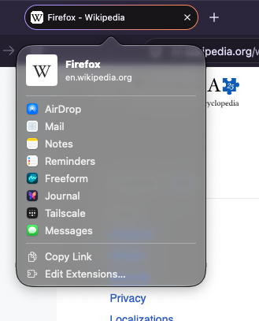

+++
title = "Firefox 159.0"
date = 2026-10-28
# updated =
description = "Release 159.0 · ESR 153.6.0esr · Beta 160.0b1 · Developer Edition 160.0b1 · Nightly 161.0a1"
[taxonomies]
categories = ["__04__Firefox"]
tags = ["firefox", "web", "release-note"]
[extra]
lang = "ja"
toc = true
math = true
mermaid = true
+++

[Firefox 159 - 2026/10/27 に Release チャンネルユーザー向けにリリースされています](https://www.firefox.com/en-US/firefox/159.0/releasenotes/)

(Release 159.0 · ESR 153.6.0esr · Beta 160.0b1 · Developer Edition 160.0b1 · Nightly 161.0a1)

## Features

- macOS でタブを共有する際，OS 標準の共有ピッカーが使用されるようになりました
  - ページのプレビューや最近の連絡先に加え， AirDrop やメッセージ，その他のアプリが表示されるようになります．
  - また，複数タブを一度共有することが可能です．



- 保存されたパスワードはデフォルトでサイドバーから利用できるようになりました


- Smart Window において，価格の値下がりや再入荷の変更などをページで監視できるようになりました (段階的ロールアウト)
  - チャットに `/watch` を入力して設定することができます．
  - 条件に一致するものが検出された際に Firefox からデスクトップ通知が届くようになります．
  - 監視設定はツールバーの **タスク** ボタンか `about:smartwindowtasks` ページから管理できます．

## Fixed


- ファイルのアップロード時に表示されるダイアログが，最後にアップロードに使用したフォルダではなく，「ダウンロード」などファイルに最後に保存されたフォルダで開いてしまう問題を修正
- Zoom などの Web アプリなどのサイトを最小化ウィンドウのまま開いていると，メモリ使用量が急増してしまう問題を修正
- Windows で NVIDIA RTX Video HDR が有効になっている場合，一部の動画が正しく表示できない問題を修正
- Google アカウントにログインしている Google Chrome のプロファイルからブックマークを正しくインポートできない問題を修正
- macOS の Apple Writing Tools において， Gmail などの一部サイトで **置換** ボタンをクリックすると，上書きされたテキストではなくクリップボードの内容が挿入されてしまう問題を修正
- Web ページ常の長いドロップダウンリストで，リストをスクロールするまで最後のオプションの場所に空白に表示されることがある問題を修正
- Slack など一部のサイトで HTTP/3 リクエストが拒否された際に HTTP/2 へフォールバックできずに，読み込みが失敗していた問題を修正
- Linux で AMD 製GPUを使用している際， ChatGPT など一部のサイトで，地図や場所の検索結果を表示すると，メモリ使用量が急増してしまう問題を修正
- macOS 上のブラウザゲームで，ゲームパッドのボタンを素早く押すと反応しなくなる問題を修正
- Linux で Wayland を使用している際，タブをクリックすると新しいウィンドウと作成されてしまう問題を修正
- Windows および Linux で，OS のアニメーション効果がオフになっている場合に，メニューやパネルがフェードインしてしまう問題を修正
- [その他多くのセキュリティ不具合を修正](https://www.mozilla.org/security/advisories/mfsa2026-118/)

## Changed

- macOS において， ChatGPT などデフォルトのブラウザを使いサインインするアプリは Firefox がデフォルトのブラウザに設定されている場合， Safari などではなく Firefox としてサインインページが開くように
- AI チャットのサイドパネルにおいて， **要約** ページを使用するとページのテキストではなく URL が送信されるように
  - これにより長いページでも要約が途中で切り詰められることがなくなりました．
- 開いているタブをキーボードショートカットで検索できるように
  - Windows および Linux では **Ctrl + Shift + A**
  - macOS では **Cmd + Shift + A**
    - これにより，拡張機能・テーマのショートカットはそれぞれ **Ctrl + Shift + F**, **Cmd + Shift + E** になりました．
  - これらのキーボードショートカットは `about:keyboard` で変更できます．
- ジャワ文字，パリ文字，カナダ先住民音節文字，ンコ語で記述された Web アドレスはエンコードされた `xn--` テキストではなく，それぞれの言語の文字で表示されるようになりました

## Developer

[Firefox 159 release notes for developers (Stable)](https://developer.mozilla.org/en-US/docs/Mozilla/Firefox/Releases/159)

### CSS

- Scroll-driven animations がデフォルトで有効化
  - スクロールコンテナのスクロール位置を timeline にしてアニメーションできるようになりました ([bug 1324602](https://bugzilla.mozilla.org/show_bug.cgi?id=1324602))

```css
@keyframes grow {
  from { transform: scaleX(0); }
  to   { transform: scaleX(1); }
}

/* ページ全体のスクロール量に連動する進捗バー */
.progress {
  position: fixed;
  inset: 0 0 auto 0;
  height: 4px;
  transform-origin: left;
  animation: grow linear both;
  animation-timeline: scroll(root block);
}

/* 要素がビューポートに入る進行度に連動するフェードイン */
.reveal {
  animation: fade-in linear both;
  animation-timeline: view();
  animation-range: entry 0% cover 40%;
}
@keyframes fade-in {
  from { opacity: 0; translate: 0 2rem; }
  to   { opacity: 1; translate: 0 0; }
}
```

- 旧 masonry 構文 (削除)
  - `grid-template-columns` / `grid-template-rows` の masonry 値と，`masonry-auto-flow` プロパティが削除されました．
  - これらは Nightly 限定で，`layout.css.grid-template-masonry-value.enabled` で制御可能な構文でした．
  - 後継は grid lanes layout で，display の grid-lanes / inline-grid-lanes を使います ([bug 2077170](https://bugzilla.mozilla.org/show_bug.cgi?id=2077170))．

```css
/* 削除された旧構文 */
.gallery {
  display: grid;
  grid-template-columns: masonry;
  masonry-auto-flow: next;
}

/* 後継の grid lanes（構文イメージ） */
.gallery {
  display: grid-lanes;
  grid-template-columns: repeat(auto-fill, minmax(200px, 1fr));
  gap: 1rem;
}
```

### APIs

- パース中にサニタイズできるように
  - `Element.setHTML()` などで，全マークアップをパースしてから DOM ツリーを掃除する方式は廃止されます．
  - 今後はパースしながら不要な要素・属性を取り除きます．
  - 結果は同じですが，隣接するテキストが複数の text node に分割されず，1つの text node にまとまります

```js
const div = document.createElement("div");
div.setHTML("foo<script>alert(1)</script>bar");

console.log(div.textContent);        // "foobar"（変わらない）
console.log(div.childNodes.length);  // 159 では 1（text node が結合される）
```

- `EXT_texture_mirror_clamp_to_edge`
  - 対応ドライバのデバイスで利用でき，MIRROR_CLAMP_TO_EDGE_EXT という wrap mode が追加されます．
  - 座標 -1〜0 は鏡像をサンプリングし，-1 未満や 1 超は端に clamp されます．グローのような左右対称の画像を，半分だけのテクスチャで表現できます ([bug 1908749](https://bugzilla.mozilla.org/show_bug.cgi?id=1908749))

```js
const ext = gl.getExtension("EXT_texture_mirror_clamp_to_edge");
if (ext) {
  gl.bindTexture(gl.TEXTURE_2D, glowTexture); // 半分だけのテクスチャ
  gl.texParameteri(gl.TEXTURE_2D, gl.TEXTURE_WRAP_S, ext.MIRROR_CLAMP_TO_EDGE_EXT);
  gl.texParameteri(gl.TEXTURE_2D, gl.TEXTURE_WRAP_T, ext.MIRROR_CLAMP_TO_EDGE_EXT);
}
```

- `EXT_texture_norm16` がデフォルト有効化
  - 16-bit normalized のテクスチャ / renderbuffer フォーマットが使えます．
  - 標高マップや医用画像など，8-bit では精度が足りないデータ向けです．対応ドライバのデバイスで有効になります ([bug 1735401](https://bugzilla.mozilla.org/show_bug.cgi?id=1735401))．

```js
const gl = canvas.getContext("webgl2");
const ext = gl.getExtension("EXT_texture_norm16");

if (ext) {
  const heightData = new Uint16Array(width * height); // 標高データなど
  gl.bindTexture(gl.TEXTURE_2D, tex);
  gl.texImage2D(
    gl.TEXTURE_2D, 0, ext.R16_EXT, width, height, 0,
    gl.RED, gl.UNSIGNED_SHORT, heightData
  );
}
```

- Scoped custom element registries
  - shadow tree ごとに独立した CustomElementRegistry を持てるようになりました．
  - その定義は該当の DOM subtree にだけ適用されるので，同名の Web Components が衝突する問題を避けられます．
  - `customElementRegistry` プロパティは Document，Element，ShadowRoot で使え，新しい registry は `CustomElementRegistry()` コンストラクタで作ります ([bug 2070506](https://bugzilla.mozilla.org/show_bug.cgi?id=2070506))．


```js
class V1Button extends HTMLElement {
  connectedCallback() { this.textContent = "v1 button"; }
}
class V2Button extends HTMLElement {
  connectedCallback() { this.textContent = "v2 button"; }
}

customElements.define("my-button", V1Button);   // グローバル

const scoped = new CustomElementRegistry();     // スコープ用
scoped.define("my-button", V2Button);           // 同名でも衝突しない

const host = document.createElement("div");
const shadow = host.attachShadow({ mode: "open", customElementRegistry: scoped });
shadow.innerHTML = "<my-button></my-button>";   // V2Button として扱われる

console.log(shadow.customElementRegistry === scoped); // true
```

### WebDriver conformance (WebDriver BiDi, Marionette)

- 推奨 preferences が default value として設定されるようになりました ([bug 2074275](https://bugzilla.mozilla.org/show_bug.cgi?id=2074275))．
  - user value ではなくなったため，異常終了後に prefs.js に残らなくなります．
- `--remote-allow-system-access` 引数が削除されました ([bug 2054896](https://bugzilla.mozilla.org/show_bug.cgi?id=2054896))．
  - 環境変数 `MOZ_REMOTE_ALLOW_SYSTEM_ACCESS=1` で代替します．
- また，メモリリークが修正されました ([bug 2079758](https://bugzilla.mozilla.org/show_bug.cgi?id=2079758))．
  - 内部のポーリング処理がエラーでタイムアウトした後もシャットダウンまで動き続けていました．
  - `browsingContext.traverseHistory` など複数のコマンドが対象です．
  - コード側で変更することはありません．

- `emulation.setMediaFeaturesOverride` コマンドが実装されました ([bug 2064354](https://bugzilla.mozilla.org/show_bug.cgi?id=2064354))．
  - CSS media feature の値を上書きできます．現時点で対応しているのは prefers-color-scheme のみです．

```js
{
  "id": 1,
  "method": "emulation.setMediaFeaturesOverride",
  "params": {
    "features": [{ "name": "prefers-color-scheme", "value": "dark" }],
    "contexts": ["<browsing context id>"]
  }
}
```

- Firefox 固有の WebDriver BiDi 拡張について，machine-readable な CDDL ファイルが追加されました ([bug 2057588](https://bugzilla.mozilla.org/show_bug.cgi?id=2057588))．
  - 型定義を機械的に取り込むクライアント実装で使えます．

### Experimental

`about:config` で該当する preference を true にすると試せます．

- CSS numeric factory functions が worker / worklet で利用可能に
  - `layout.css.namespace.exposed-in-workers-and-worklets` を true にします．
  - CSS.px() などの numeric factory functions が，Window だけでなく worker と paint worklet でも使えます．
  - CSS Typed OM API の一部なので，Nightly 以外では `layout.css.typed-om.enabled` も true にする必要があります ([bug 2079188](https://bugzilla.mozilla.org/show_bug.cgi?id=2079188))

```js
// worker 内
const w = CSS.px(100);
console.log(w.value, w.unit); // 100 "px"
```

- `MathMLAnchorElement` の新プロパティ
  - `mathml.a.element.enabled` を true にします．
  - `download`，`ping`，`rel`，`relList`，`referrerPolicy` が使えるようになります ([bug 2064612](https://bugzilla.mozilla.org/show_bug.cgi?id=2064612))．

```js
const a = document.querySelector("math a");
a.rel = "noopener";
a.referrerPolicy = "no-referrer";
a.relList.add("noreferrer");
a.download = "formula.mathml";
```

----

Firefox Enterprise の更新と修正については [Firefox Enterprise Release Notes](https://www.firefox.com/firefox/enterprise/159.0/releasenotes/) を，ポリシーの変更については [Firefox admin docs changelog](https://firefox-admin-docs.mozilla.org/release-notes/version/firefox-159/) を参照してください．
