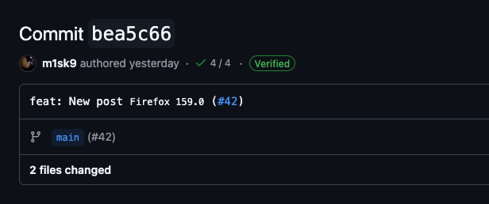
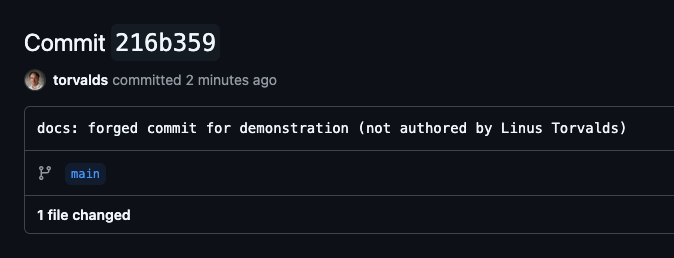
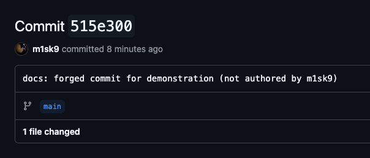
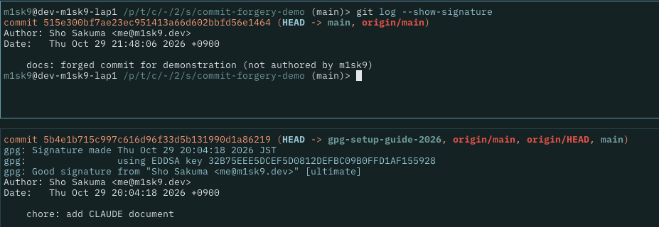
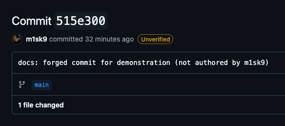

+++
title = "コミット偽造とは?"
date = 2026-10-29
# updated =
description = "Git の Author は自己申告にすぎず，誰でも他人になりすましてコミットできます．コミット偽造の仕組みと，コミット署名で防げること・防げないことをまとめます．"
[taxonomies]
categories = ["__02__Security"]
tags = ["gnupg", "yubikey"]
[extra]
lang = "ja"
toc = true
mermaid = true
+++

Git のコミットに記録される作成者情報は，誰でも自由に書き換えられます．この性質はサプライチェーン攻撃でも実際に悪用されています．

2025 年 3 月に GitHub Actions の `tj-actions/changed-files` が侵害された事件では，攻撃者は Renovate bot になりすましたコミットを混入させました．

Wiz の分析では，このコミットに GitHub の検証 (Verified) が付いていなかったことから，Renovate のアカウント自体は侵害されていないと判断されています ([Wiz: GitHub Action tj-actions/changed-files supply chain attack](https://www.wiz.io/blog/github-action-tj-actions-changed-files-supply-chain-attack-cve-2025-30066))．

この記事では，コミット偽造がどのように行われるか，コミット署名でどこまで防げるのかを整理します．

## コミット偽造とは

Git のコミットは本来作成者の情報として次のものを持ちます．

- `username`: ユーザーの名前
- `email`: ユーザーの Email アドレス

[このポートフォリオのコミット](https://github.com/m1sk9/m1sk9.dev/commit/bea5c66be7f0f9557db207524cb23e5c8b2f5874) にもこのように私の情報が記録されています．

```sh
commit bea5c66be7f0f9557db207524cb23e5c8b2f5874
Author: Sho Sakuma <me@m1sk9.dev>                   # この部分に記録されている
Date:   Wed Oct 28 22:21:53 2026 +0900

    feat: New post `Firefox 159.0` (#42)

diff --git a/content/posts/firefox-159.0/index.md b/content/posts/firefox-159.0/index.md
new file mode 100644
index 0000000..2c97339
--- /dev/null
+++ b/content/posts/firefox-159.0/index.md
@@ -0,0 +1,252 @@
```

GitHub などのバージョン管理プラットフォームはこの Author の情報を使い，アカウントと Git 上の Author を紐づけています．紐づけに使われるのは Author の Email アドレスで，それが GitHub アカウントに登録された Email と一致すると，そのアカウントが作成したコミットとして表示されます．



このコミットは実際に私が作成したので GitHub 上に表示されている情報は全て正しいですが，第三者がこの Author の情報を使ってコミットをした場合どうなるでしょうか．

### コミットを偽造してみる

では実際にコミットを偽造してみます．今回はプライベートリポジトリで行っています (教育目的の実演なので真似しないでください)

`.gitconfig` にて次のように Author を設定します．

```gitconfig
[user]
    name = Linus Torvalds
    email = torvalds@linux-foundation.org
```

この状態でコミットしてみると，GitHub 上ではリーナスが作成したコミットのように表示されます．



**実際にはリーナスはこのリポジトリには関与していないのに，第三者からリーナスが作成したコミットのように見えます**．これがコミット偽造です．

## コミット署名はどういうものなのか

ではこのような偽造を防ぐにはどうすればいいでしょうか．そこで使うのはコミット署名です．

コミット署名というのはコミットの内容に対して作成者が電子署名を付ける仕組みです．鍵は2つのペアを使用します．

- **秘密鍵**: 署名を作るための鍵．作成者だけが持ちます．
- **公開鍵**: 署名を検証するための鍵．GitHub などに登録して公開します．

実際公開鍵は GitHub に登録すると第三者にも表示されるようになります．(私の公開鍵は [`https://github.com/m1sk9.gpg`](https://github.com/m1sk9.gpg) でみれます)

コミット署名は次の流れで行われます．


flowchart LR
  a["コミットを作成"] --> b["秘密鍵で署名"]
  b --> c["push"]
  c --> d["GitHub が登録済みの公開鍵で検証"]
  d --> e["一致すれば Verified"]


ここで重要なのは，**署名の作成に秘密鍵が必要**という点です．

先ほどのコミット偽造は，`author` の行を書き換えるだけで成立しました．偽造者は私の秘密鍵を持っていないため，私の名前で作ったコミットに有効な署名を付けることができません．また，署名付きの本物のコミットの `author` を書き換えた場合も，署名と内容が一致しなくなり検証に失敗します．

結果として，偽造されたコミットには Verified が付かず，署名のある本物のコミットと区別できます．


<div style="text-align: center; font-size: 0.80em; color: #888; margin-top: 8px;">
    本来ついているはずの Verified バッジが付かない
</div>

`git log --show-signature` の出力も変わります．上が偽造したコミット，下が署名付きの本物のコミットです．本物のほうだけ `Good signature` の行が出力されます．



### 「Verified が付かない」の意味に注意

ここで注意したいのは，**署名のないコミットは「検証に失敗した」のではなく，そもそも検証の対象外**ということです．

GitHub の既定では，署名のないコミットには何のバッジも付きません．偽造コミットが Unverified と赤く表示されるわけではなく，**バッジがないことに受け手が気づく必要があります**．

この弱点を補う設定が 2 つあります．

- **Vigilant mode**: 自分の Author で作られた署名なしコミットを，Unverified として表示させる設定です．GitHub の `Settings` → `SSH and GPG keys` → `Vigilant mode` で有効にできます．
- **Require signed commits**: ブランチ保護の設定で，署名され検証されたコミットだけを受け付けるようにします．

Vigilant mode を有効にすると，先ほどの偽造されたコミットは次のように表示されます．



詳細は GitHub の公式ドキュメントを参照してください．

- [About commit signature verification](https://docs.github.com/en/authentication/managing-commit-signature-verification/about-commit-signature-verification)
- [Displaying verification statuses for all of your commits](https://docs.github.com/en/authentication/managing-commit-signature-verification/displaying-verification-statuses-for-all-of-your-commits)

### GitHub 上のマージでは署名が置き換わる

GitHub の Web UI でマージしたコミットは，GitHub が自身の鍵で署名します．実際に，冒頭で紹介したこのポートフォリオのコミット `bea5c66` (PR の squash merge) を確認してみると，次のようになっていました．

- Author は `m1sk9` (私自身)
- Committer は `GitHub <noreply@github.com>`
  - 署名は私の鍵ではなく GitHub の鍵によるもの

つまり，自分の鍵で署名したコミットを含む PR を squash merge しても，base ブランチに入るコミットは私の署名ではなく GitHub の署名になります．

Verified は付きますが，これは「GitHub がマージした」ことを示すものです．また，GitHub のドキュメントによれば，Rebase and merge では GitHub がコミットを作り直すため，元のコミットの署名は検証されなくなります．

自分の鍵での署名を残したい場合は，ローカルでマージして push する必要があります．

## 署名で防げないこと

コミット署名は万能ではありません．

- 署名が保証するのは「その鍵の持ち主が作成した」ことだけで，**コミットの内容が安全であることは保証しません**．
- 秘密鍵が漏洩したり，署名を行う環境が侵害されたりした場合は，攻撃者が正規の署名を付けられてしまいます．
- 署名が付いていても，受け手が確認しなければ意味がありません．

秘密鍵の保護には，YubiKey のようなハードウェアキーに秘密鍵を置く方法があります．鍵が端末から取り出せなくなるため，マルウェアによる鍵の窃取を防ぎやすくなります．

## まとめ

- Git の Author は自己申告であり，誰でも偽造できる．
- コミット署名を使うと，偽造コミットを本物と区別できる．
- ただし，署名なしのコミットは既定では何も表示されない．Vigilant mode やブランチ保護と組み合わせて使う．
- GitHub 上のマージでは，署名が GitHub のものに置き換わる．
- 署名は鍵の持ち主を保証するだけで，内容の安全性までは保証しない．

みなさんもコミット署名しましょう．
